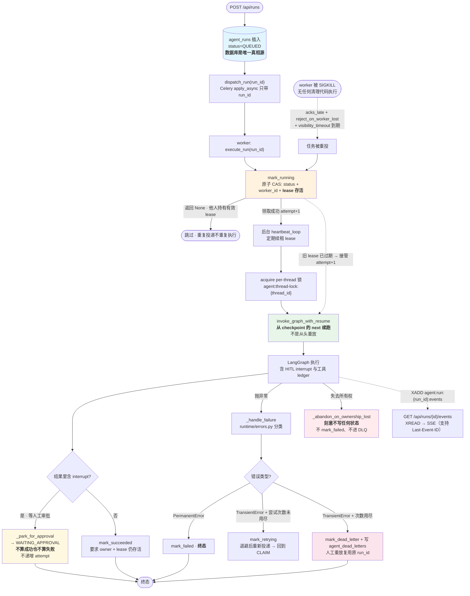

# Architecture

**工业运行时增量（候选）**：保持同一 LangGraph 与同一耐久 Runtime；新增身份准入及状态所有权边界，不新建 Agent 框架。[工业发布契约](architecture/industrial-runtime-admission.md) 记录实现与未完成门禁。未合并、未同 SHA 验收的功能不计为 main 已交付。

> 🟢 CURRENT — 随代码与配置同步更新。本文只写**结构性事实与设计理由**；
> 版本号、模型名、路径数等会漂移的数值一律去
> [reference/current-state.md](reference/current-state.md) 与
> `python3 scripts/project_facts.py` 取，**本文不硬编码**。
>
> 更细的设计文档在 [design/](design/)；本文是**入口与"为什么"**。

---

## Architecture decision freeze — 2026-11-25

**主架构：LangGraph 路由式领域工作流 + 受限 ReAct + 双执行路径。** 本仓承担客服业务编排、工具治理、人工审批和耐久运行时；不承担通用执行沙箱、跨任务用户画像或独立 RAG 算法实验。Beauty RAG 与本仓属同一早期任职阶段；Gaobao 为另一期任职。当前公开工程治理不是历史生产交付证明。

| 设计 | 裁决 | 边界 / 验收 |
|---|---|---|
| 快路径 / 异步路径 | 保留 | 只读快路径；有副作用或待审批任务进入耐久路径；服务端权限而非模型自报 |
| 领域 Agent | 保留接口，按收益裁剪 | 七个领域角色不是七个独立服务；仅在工具、权限、策略或协作收益不同时拆分；与单专家基线比较路由正确率、调用次数、时延及失败 |
| ResponseAgent | 定性为确定性后处理节点 | process 做清洗、质量规则、缓存、事件；不额外算自主 LLM Agent；保留兼容类名，禁止无必要模型调用 |
| ReAct / 协作模式 | 条件启用 | 简单查询直接工具/专家；仅复杂任务启用协作；限制循环、传播部分失败及未完成审批 |
| MCP | 按实际工具所有权启用 | 默认关闭；#72 的版本化 SKU 支持文档经统一注册表接入；合成 FAQ 仅协议回归，实际目录须经授权验收 |
| A2A | 按独立服务所有权启用 | 默认关闭；#73 售后程序专家只接收枚举化描述，loopback、摘要锁定目录，不授权写入；真实网络/目录验收仍缺 |
| Redis lease / PostgreSQL CAS | 保留，不夸大 | 锁、owner CAS、工具账本职责不同；旧 worker 的外部请求不能仅靠本地 CAS 撤销 |
| ERP 写操作 | 安全优先 | 外部结果不明时禁止盲重试；需要外部幂等键、结果查询或人工对账；未确认写入不得报告成功 |
| Cache / Memory | 保留独立责任 | Cache 可重建；Session 是上下文；Checkpoint 是图状态；AgentRun/ledger 是持久业务事实；缓存不能授权写操作 |

**架构裁剪门禁**：先检查调用路径与兼容接口，再以同数据/任务对比单专家和协作模式；没有收益的角色合并为普通节点或规则函数。真实 ERP 未授权时只做 mock/故障契约，不当作生产通过。本次保持外部接口和安全配置；取消无条件路由预取，按需检索。具体删改必须有回归测试及同 SHA CI。先完成架构裁剪，再单独治理能力缺口。

### 执行模式收敛与验收边界（#75）

- `SequentialMode` 与 `ReActMode` 保持路由标识和各自 SLA，但复用单专家执行边界；它们不是两套 Runtime。真实返回契约包括 `pending_actions`、`tool_executions`、读取降级状态；不得为减少节点而丢弃审批或工具回执。单领域投诉默认不进入层级协作；跨领域仍按业务需要路由。
- ResponseAgent 是确定性响应后处理节点。七个领域角色是进程内职责划分，不等于七个独立服务或每次请求调用七次模型。角色是否进一步合并以同一任务集上的工具权限、错误、审批透传、调用次数及质量差异决定。
- #77 的未知外部副作用拒绝重放已纳入 #76 统一架构验收。Redis lease / owner CAS 不等于存储端 fencing，不保证已经发出的外部请求被撤销。
- #73 和 #72 为独立业务能力接入，已合并到 main；不作为本轮架构裁剪通过的依据。此节记录本分支设计和验收契约，实际交付以合并后的代码及同 SHA CI 为准。

### 编排模式术语裁决（#75）

业界没有强制统一的五种模式。参照 [Anthropic Building effective agents](https://www.anthropic.com/research/building-effective-agents)、[OpenAI multi-agent orchestration](https://openai.github.io/openai-agents-python/multi_agent/) 和 [Microsoft Agent orchestration patterns](https://learn.microsoft.com/en-us/azure/architecture/ai-ml/guide/ai-agent-design-patterns)，按实际控制流归类而非按类名计数。

| 现有兼容标识 | 准确工程术语 | 裁决 |
|---|---|---|
| sequential | Routing → single specialist（直接路由） | 保留快路径；不是多 Agent 串行链 |
| parallel | Static fan-out/fan-in（并行分发与确定性拼接） | 保留独立领域查询；同一角色只执行一次 |
| consultation | Fixed specialist fan-out → primary synthesis（固定主从咨询） | 辅助专家先返回，再由主专家汇总；不是动态 agents-as-tools 或 handoff |
| hierarchical | Fixed subtask fan-out → coordinator synthesis（固定任务主从汇总） | 子任务由代码确定，不是 LLM 动态规划的 Orchestrator–Workers；与 consultation 归为同一模式族 |
| react | Bounded single-agent tool loop | 单 Agent 内部执行策略，不计为多 Agent 协作模式 |
| quality_gate / mode_upgrade_retry | Rule-based evaluation + at most one safe retry | 不是双 LLM Evaluator–Optimizer；不重放已有工具/审批的任务 |

主架构为 Routing；多 Agent 仅保留并行分发与固定主从汇总两个模式族，ReAct 属于内部执行策略。兼容节点名、SSE/监控标识及 checkpoint 不改名。不存在 Group Chat/Swarm 的业务需求，不为凑模式新增；人工转接与 AI peer handoff 也必须区分。

**状态归属整改**：consultation/hierarchical 的合成输入仅使用本次调用返回的结果，不再读取 session Blackboard 的历史前缀。Blackboard/Bus 可继续用于诊断与现有兼容接口，非当前任务事实来源；结构化工具回执/审批与自然语言分离。Parallel 去重、consultation 禁止主专家自我咨询及重复辅助。以回归测试验证旧黑板内容不进入汇总、同一角色不重复执行。咨询与层级的业务收益及关键词选择阈值仍需配对任务评测；不凭命名或 fixture 通过宣称质量提升，不贸然删掉已存在的兼容路径。

### 标准执行实现收敛

`RoutingMode` 是单专家执行器，旧 `SequentialMode` 仅保留导入别名；ReAct 复用 Routing 执行边界。Parallel 与固定 `SupervisorWorkersMode` 共用 `_fan_out` 的任务创建、超时、取消清理、已完成结果采纳及写失败传播。Consultation / Hierarchical 不再分别拥有汇总执行实现，仅负责将旧上下文转换成固定 worker 分配与 SLA/事件兼容策略，统一由 supervisor 汇总当前调用结果。固定 Supervisor–Workers 是静态 workflow，非动态规划型 Orchestrator–Workers。

不迁移持久化图节点标识：旧 checkpoint、SSE、metrics 和审计仍能解析，保留旧标识不代表保留五种实现。新增两个兼容 profile 的同契约测试（已完成兄弟回执、审批、超时降级和取消清理），及 supervisor 自执行防护。真实任务收益仍需配对评估，同 SHA CI 未完成前不宣称已上线。

### 配对验收（离线契约与真实收益分离）

`tests/unit/test_collaboration_modes.py::test_paired_routing_architecture_contract` 在相同查询、相同角色事实、独立初始化的模拟专家上比较直接 Routing 与实际编排选择；使用真实执行器与固定路由参数，非重写模拟执行器。冻结三个预期：单域投诉 1 次角色调用且覆盖投诉；产品/退款并行 2 次且覆盖产品和账务；过敏投诉固定主从 3 次（投诉、技术、协调者），覆盖两种领域回执。基线始终 1 次主专家调用。以上是测试断言，不是已测结果；覆盖指合成 fixture 的结构化回执，不代表真实答案质量、模型调用次数、时延或业务收益。真实配对评估仍需独立人工标注、相同授权数据、模型与预算、实测 token/工具调用、P50/P95 延迟、业务正确性和失败传播。不能以模拟测试替代。

## 1. 一句话架构

> 一个**同步快路径 + 异步耐久路径**并存的企业客服 Agent 服务：
> 前者用 LangGraph 实时编排多 Agent 回答请求，后者把长任务落库入队、
> 由 Celery worker 从 Postgres checkpoint 续跑，并给每一次工具副作用
> 加持久化幂等记账、执行所有权及未知结果对账约束（不保证外部 ERP exactly-once）。

---

## 2. 为什么是两层执行路径（Hybrid）

企业客服有两类根本不同的负载，用同一套机制处理会两头都差：

| 负载 | 特征 | 要求 | 选择的路径 |
|---|---|---|---|
| 用户在线等回答 | 秒级、无副作用、可重试 | **低延迟 + 简单** | 快路径：`POST /api/chat`（+`/api/chat/stream` SSE）**永远 inline**，不经 worker |
| 长任务 / 高危写操作 | 可能超时、需要人工审批、需要崩溃恢复 | **可恢复 + 可审计** | 异步路径：`POST /api/runs` → Celery → `GET /api/runs/{id}` |

**为什么不把快路径也异步化？** 用户在等一个"这个产品有没有刺激成分"的回答，
把它塞进队列只会凭空增加一跳延迟，而且失败后用户已经走了。
**为什么不把长任务也走同步？** 需要人工审批的写操作可能挂几十分钟到几小时，
HTTP 连接不可能等；而且同步进程崩溃 = 状态丢失。

快路径与异步路径**共享同一份图与同一个 checkpointer**（都经 `ServiceContainer.initialize()`），
所以这不是两套系统，是同一条流水线上的两个入口。

### 2.1 异步路径的一次执行（含崩溃恢复）

`runtime/executor.py::execute_run` 是异步路径唯一的执行入口。
图里最关键的一条线是**崩溃恢复**：worker 被 `SIGKILL` 之后没有任何"清理代码"
会跑，恢复完全靠**任务重投 + lease 过期 + checkpoint 续跑**三件事的组合。



四个容易被讲错的点：

| 点 | 准确说法 |
|---|---|
| 交付语义 | **at-least-once**，不是 exactly-once。`acks_late` + `reject_on_worker_lost` + Redis `visibility_timeout` 允许任务被重投和重复执行，仍需正确的故障恢复条件 |
| 幂等边界 | run 级终态 no-op、thread 锁、工具账本原子 claim 抑制重复；不能保证外部 ERP exactly-once，结果未知时需查询或对账 |
| 崩溃恢复靠什么 | 不靠优雅关闭：靠**任务重投 + lease 过期接管 + 从 checkpoint `next` 续跑**。已持久确认成功的工具回执用于抑制重做；外部成功但未持久化的窗口需对账 |
| 事件流不是真相源 | Redis Stream → SSE 是**观测通道**：best-effort 可续读，**非 exactly-once**。真相永远是 `agent_runs` 表 |

> **Level 2 ≠ 生产验证。** 上述流程已用真实 PostgreSQL + Redis + 多进程 Celery
> 验收过（`make runtime-e2e`）并做过 SIGKILL 崩溃恢复验证（`make runtime-chaos`）；
> 但**真实生产集群、多副本长期运行、真实流量**全部 `NOT_VERIFIED`。
> 完整边界见 [limitations.md](limitations.md) §3。

---

## 3. 请求生命周期（快路径）

```
POST /api/chat  或  /api/chat/stream
   │
   ├─ auth / 限流 / 输入净化 / Token Quota
   ├─ acquire per-thread 分布式锁 (Redis Lua CAS)
   │     同一 thread_id 串行，不同 thread 并发
   │
   └─ graph.ainvoke(initial_state, {"configurable":{"thread_id": session_id}})
         │
         ┌─[Layer 0]─ check_cache ────────────────► final_response ──► END
         │            L1 Redis MD5 精确
         │            L2 Qdrant 向量语义
         │            L3 Jaccard 词面回退
         │            命中 → 直接产出（伪流式补齐）
         │            未命中 ↓
         │
         ┌─[Layer 1]─ classify_query
         │            LLM 分类器 ‖ 规则分类器（asyncio.gather）
         │            高置信规则（≥0.75）→ 短路，不调 LLM
         │            不做全局 RAG 预取，领域 Agent 按需检索
         │            产出 query_type / complexity / domain hints
         │
         ├─[Layer 2]─ 条件边选协作模式
         │            sequential | parallel | consultation | hierarchical | react
         │            （兼容图标识保留；执行器归并为直接路由、并行分发、固定主从三类）
         │
         ├─ human_approval_gate
         │     pending_actions 非空 → LangGraph interrupt()
         │     空 → 纯 no-op（普通流量零开销）
         │
         ├─ quality_gate（仅无工具/审批活动的低分 sequential 可升级）
         │     mode_upgrade_retry 最多一次 → human_approval_gate
         │     否则 ↓
         └─[Layer 3]─ final_response
                     最终规则质量评估（不再次调度）
                     缓存写入（仅 resolved）
                     SLA 监控 / 事件广播
```

节点与边的**逐行定义**在 `core/graph_builder.py::build_graph`。本文只解释结构与理由。

---

## 4. 为什么是四层状态机而不是一坨 if-else

四层是**四种不同的失败模式**，每层有自己的兜底策略：

| 层 | 要解决的问题 | 兜底 | 成本 |
|---|---|---|---|
| **L0 缓存** | 重复、无状态且允许复用的问题 | 符合资格才返回，不进 LLM | 命中率、时延及成本收益须实测 |
| **L1 路由** | 选错 Agent = 后面全错 | LLM 失败 → 规则分类器 → 规则也失败 → 熔断到默认 Agent | 中等 |
| **L2 协作** | 复杂问题需要多视角（投诉要产品+技术+客服） | 路由、领域与复杂度选择分支；成本须实测 | 最贵 |
| **L3 后处理** | 模型可能答得不好 | 低规则评分且无工具/审批活动时最多一次安全重试 | 按需 |

**为什么路由要双层并行？** LLM 分类更准（能理解"这个成分会不会刺激"），但慢且会挂；
规则分类快且免费，但只能覆盖高频模式。并行跑然后择优，等于**同时拿到准确率和可用性**，
且规则高置信时可以**直接短路省掉 LLM 调用**（这是成本优化，不是正确性妥协——
高置信规则只在明确模式下才短路）。

**为什么缓存放在路由之前？** 缓存命中意味着**连意图都不需要识别**。反复问同一个问题的
用户，不该付出任何 LLM 代价。放路由之后等于强迫每次都先花钱分类。

---

## 5. 状态、节点与边：LangGraph 用了什么、没用什么

### 5.1 State
`core/state.py:6` 的 `AgentState` 是一个 `TypedDict(total=False)`，
**单一定义点**，全仓无第二份 schema。它承载 session/agent/query/response/
collaboration_mode/cached/agents_used/resolution_status/trace_id/多模态/HITL 字段。

> LangGraph 仅持久传递 schema 声明的 channel；`total=False` 仅意味着字段可缺省，不意味着任意键自动传递。`_needs_upgrade` / `_retried` 已声明。路由阶段原先写入的 `_rag_prefetch` 未声明，且不应为每个请求无条件检索，故已取消该预取；领域 Agent 的统一检索入口仍可按需工作。其他临时键必须逐一核查其生产者、消费者和生命周期，不能直接声称跨节点传播。

### 5.2 编译
`core/graph_builder.py:453-457`：

```python
compile_kwargs = {}
if checkpointer is not None:
    compile_kwargs["checkpointer"] = checkpointer
app = workflow.compile(**compile_kwargs)
```

**只传 checkpointer。刻意不传的**：
- `store` → 没有 LangGraph 级长期记忆。跨会话记忆由
  `core/session/session_manager.py` 承担，与 checkpoint 是**明确分离的两个概念**
  （见 [design/runtime-state-ownership.md](design/runtime-state-ownership.md)）。
- `interrupt_before` / `interrupt_after` → 静态断点无法表达"**只有 HIGH 风险工具**
  才需要人工"这种数据相关条件。本项目用节点内 `interrupt()`，
  见 `core/hitl/gate.py:205`。
- `cache` / `name` → 未使用。

### 5.3 条件边的路由映射必须穷举
`classify_query` 的条件边（`core/graph_builder.py:430-440`）的路由表**只列了
5 个协作模式，没有 fallback 分支**。这是有意的：如果 `select_mode_name` 返回
表外字符串，LangGraph 会在运行时**报错**而不是静默走一条不存在的路。
**枚举穷举 = 失败可见**，优于"兜底到某个默认节点"。

---

## 6. 四个 ID 必须严格区分

这是分布式 Runtime 里最容易出错、也最值得单独讲的一点：

| 名字 | 是什么 | 谁生成 | 生命周期 |
|---|---|---|---|
| `thread_id` | 对话级。**== `session_id` == LangGraph thread** | 客户端 / 服务端 | 整个会话 |
| `run_id` | **单轮执行**。= `agent_runs.id` | 服务端（`POST /api/runs`） | 一次请求-响应 |
| `task_id` | **Celery task id** | Celery | 一次投递，**重投会变** |
| `AgentRun` | 业务运行记录（数据库行） | 服务端 | 跨重投**稳定** |

**为什么必须区分**：崩溃恢复时 Celery 会用**新 task_id** 重投同一条 run。
如果把 task_id 当业务标识，工具幂等键就会变，**重试会真的重复扣款**。
所以幂等键用**内容寻址键** `build_replay_stable_operation_key`
（`runtime/side_effects.py`，身份 = `run_id + node_id + agent + tool_name +
内容指纹 + 同内容出现序号`；调用方持有稳定业务 id 时优先传 `logical_operation_id`）——
注意不能只用 `run_id:tool_call_id`：`tool_call_id` 由 LLM 生成，节点重放时会变，
同一笔逻辑写操作换键后会被执行两次。身份按**内容**而非**位置**派生，因此重放时调用
序列重排也不会让同一笔写换键（Issue #12 Part A）。
DLQ 重放**复用原 run_id**（`runtime/run_service.py:512-553`）——
两个设计旨在抑制重试导致的重复副作用；外部成功但本地未确认的窗口仍需对账。

---

## 7. 状态归属：四种"状态"互不混用

企业 Agent 最常见的架构错误是让 checkpoint、session、cache、tool store
共享一个存储后，然后祈祷它们语义一致。本项目显式分离：

| 状态 | 归属 | 真相源 | 理由 |
|---|---|---|---|
| **LangGraph checkpoint** | 图执行位置 | Postgres `AsyncPostgresSaver` | 必须跨进程、跨副本共享，否则 worker 看不到 API 写下的进度 |
| **Session Memory** | 滑动窗口 + 摘要 + 漂移检测 | Redis（生产强制） | 多 worker 分片下内存态会导致同一会话在不同 worker 看到不同历史 |
| **Response Cache** | L1/L2/L3 三层 | Redis + Qdrant | 与 checkpoint 无关的生命周期，可独立过期 |
| **Tool Result Store** | 卸载的大结果 | Redis，带 `scope` | 与 scope 强绑定，防止跨用户恢复他人结果 |

**Checkpoint 生产 fail-closed 是硬要求**：`core/container.py:341-351` 在
postgres 初始化失败时**直接抛错拒绝回退 MemorySaver**。理由——内存 checkpoint
在多副本下会给出"看起来正常但状态已经丢了"的行为，
这比启动失败**危险得多**。开发/测试环境才允许降级，且降级会**显式标记**
`status="degraded"` 并在健康检查里暴露。

---

## 8. 可观测性：三条独立的信号

| 信号 | 实现 | 用途 | 现状边界 |
|---|---|---|---|
| **Trace** | OpenTelemetry（`core/tracing.py` + `core/telemetry.py`），5 个语义 span | 一次请求跨 Agent/工具/RAG/LLM 的因果链 | **本地已验证**（对真实 Collector 验证过 span 完整性）；持久化后端**未接**（collector 仅 debug exporter） |
| **Metric** | `prometheus_client` 注册表 | 队列深度、run 状态分布、幂等命中、审批等待、工具结果压缩比 | ⚠️ **注册了约 70 个，但标准 `/metrics` 暴露未接**，详见 [limitations.md](limitations.md) |
| **Log** | 结构化 JSON + ContextVar `trace_id` + 两层密钥脱敏 | 排障取证 | 已实现；`scrub_exception_message()` 会在异常对象上就地脱敏，防止 **ASGI 自己打印 traceback 时泄漏** |

**为什么 trace 属性要做白名单 + 黑名单双层？** `core/telemetry.py:61-152`。
只靠黑名单，新增一个 `user_email` 字段就会漏；只靠白名单，
span 会丢关键排障信息。双层是"默认安全 + 显式放行"。

---

## 9. 安全边界（架构级）

| 边界 | 机制 | 关键性质 |
|---|---|---|
| 系统间调用 | API Key | 与终端用户 JWT 分离 |
| 终端用户 | JWT + Argon2id + Redis 黑名单 + Refresh Token | 4 级 RBAC |
| 工具授权 | `erp/authorization.py` **在工具层**强制 | **不靠 prompt 约束** |
| 高危工具副作用 | HITL 审批 + 幂等 ledger 双防线 | 审批防"不该做的被做了"；ledger 防"做了一次被重做" |
| 无治理写操作 | 拒绝执行（fail-closed） | 快路径无 run 上下文时尤其重要 |
| 敏感内容 | 四处独立边界：日志脱敏 / trace 属性 / 审批提案 / run 事件白名单 | 各层用**不同语义**，不能互相替代 |
| SSRF | Webhook URL 校验（拒绝私网/回环/元数据端点） | — |

---

## 10. 与本项目相关但**刻意不做**的事

写清楚不做什么，比罗列做了什么更能说明工程判断：

| 不做 | 理由 |
|---|---|
| `interrupt_before/after` 静态断点 | 无法表达数据相关的审批条件 |
| LangGraph `store` 长期记忆 | 会与 `core/session/` 职责重叠；且没有 memory schema 设计 |
| 工具结果直接进 prompt | 5000+ 文档的检索结果会撑爆上下文；走 offload + reference_id |
| 编排逻辑散落在 Agent 内部 | 状态转移必须在一个地方可审计，否则崩溃恢复无从判断 |
| 同步路径也走队列 | 给秒级交互凭空加一跳延迟 |
| Celery result backend 作为状态真相源 | `task_ignore_result=True`；真相源是 `agent_runs` 表 |

---

## 延伸阅读

| 你想知道 | 去 |
|---|---|
| 分布式 Runtime 完整设计（状态机/锁/幂等/DLQ） | [design/agent-runtime.md](design/agent-runtime.md) |
| 为什么用 LangGraph 而不是裸 Chain | [agent-design.md](agent-design.md) |
| 高危工具为什么要人工审批 | [design/human-in-the-loop.md](design/human-in-the-loop.md) |
| 四类状态的归属与理由 | [design/runtime-state-ownership.md](design/runtime-state-ownership.md) |
| 架构决策记录 | [decisions/](decisions/) |
| 当前事实与验证命令 | [reference/current-state.md](reference/current-state.md) |
| 已知不宣称项 | [limitations.md](limitations.md) |


### 协作架构裁剪：单执行边界与单域投诉

Sequential 与 ReAct 共享同一个单 Agent 执行函数，保留原模式标识、Agent 选择、独立超时及事件 sender、审批提案和执行回执传递。LangGraph 持久化节点名不变。单域投诉直接交由 complaint_agent；只有存在产品/账务等其他领域子任务才使用 Hierarchical。该规则减少无意义协调者调用，但不宣称质量或延迟收益已实测。Parallel/Consultation/Hierarchical 的独立聚合语义保留，待业务对照评测再决定是否裁剪。外部副作用的未知结果治理独立于本次重构。

### 未知外部副作用：禁止盲目接管

真实 ToolRegistry 的副作用执行明确禁止接管已开始但租约过期的 PENDING 行和 FAILED 行；成功且指纹一致仍复用已存结果，尚未开始的 reservation 可首次执行，仍有效的租约返回 in_progress。拒绝接管使用不可重试的 reconciliation-required 异常，保留 ledger 原状态。PostgreSQL 行锁和本地 owner CAS 不能证明下游未执行。低层 claim 的显式接管能力仅为本地故障测试兼容，不是外部写路径的策略。没有下游确认、稳定业务操作标识和受控对账流程前，不得重新发起未知写。此修改仅封住同一 operation_key 的重试，不证明跨新 run、变参或不同逻辑操作键的端到端去重；真正 ERP 的恢复验收仍需授权接口。

### 路由主责与耐久超时边界

Parallel 的关键词命中仅表示辅助领域，不能替代路由主责 Agent；保留主责在首位并稳定去重。协作层的耐久任务 TimeoutError 透传给 AgentRun 分类、重试与对账，不在图层包装成成功回复；普通同步查询的既有降级不变。新增真实编译图超时透传及路由主责回归，均为离线契约，待同 SHA CI；不宣称供应商 exactly-once 或实际业务收益。


### Response cache 与任务事实的边界

图入口的响应缓存不能短路 durable run、图片输入或明确人工接管请求；正常后处理仅在无工具回执、无审批、无转人工状态、无降级且满足既有 resolved 策略时写入。后处理异常的 fallback 不再写缓存。缓存存储层身份隔离保留；本改动不是对同用户多轮上下文、语义误命中或知识新鲜度的完整证明。仍需对单层精确缓存与语义/词面缓存按授权无状态 FAQ 做配对评测；缓存绝不是业务动作凭证。


### Quality retry and cache compatibility boundary

An upgraded collaboration may return tool receipts or pending approval proposals without response text. The graph propagates these independently of prose before revisiting HITL; an empty upgraded response is explicitly degraded, not a replay of the prior candidate. Response-cache payload version v3 invalidates legacy entries written before the graph-level eligibility guard. This is a cache compatibility change, not proof of context-independent or privacy-safe semantic reuse; paired cache/quality and real ERP acceptance remain pending.
