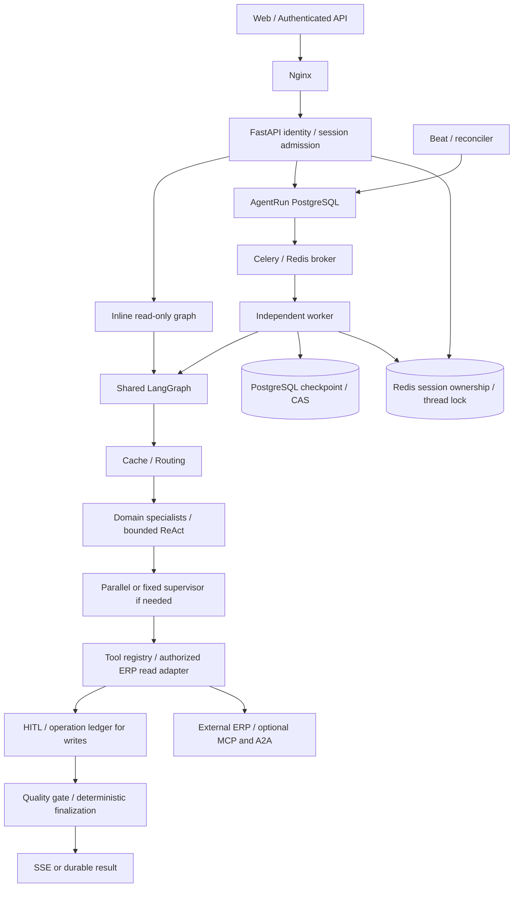

# 工业客服运行时发布契约（2026-11-25，候选）

## 基线和项目定位

审查基线 main `a1f4a66e43e138e4b2c8c51aa3cd35dd3644b919`（#81 已合并）。#80 reviewed-gold、#82 provider attempt metering 未合并；核查时 CI 仍待执行。此次候选独立于这两个 PR。公开仓库的增量工程不是早期任职生产交付的证明。

本仓负责客服业务路由、工具权限、人工审批、耐久任务与真实业务回执；复杂文档知识工程属于同任职阶段 Beauty RAG，通用受控分析沙箱属于另一任职阶段 Gaobao。不要为技术覆盖复制 Runtime。

## 唯一主架构



Seven domain roles, ReAct and Response are nine registered runtime roles, not nine autonomous services. Direct routing is the default; parallel and fixed supervisor-workers share fan-out; consultation/hierarchical are compatibility profiles. No dynamic swarm. ResponseAgent is deterministic post-processing. Standalone loop is an offline/reference lane, not an alternative online executor. Local blackboard/message bus are run-local diagnostics, not distributed authorization. Durable human handoff is distinct from write approval.

## 本轮候选改变

| 旧风险 | 新边界 |
|---|---|
| 非 dev 匿名 Run 查询/取消/事件访问放行 | 无 owner 不允许客户访问，需人工核查；新 Run 要求身份 |
| 幂等键命中不核对原始请求；并发 insert 竞争可重复 publish | 验证 query/session/user，冲突 409；只有 DB 创建赢家在 API 首次投递，reconciler 仍可能重投 |
| header/body 幂等键不一致 | 400 |
| 同步 checkpoint 探测失败当作无 pending | 非 dev 严格探测，失败或旧未完成 checkpoint 拒绝，不接管 |
| JWT refresh token 被用于普通请求、数字/字符串身份不一致 | HTTP/用户查询/WS 校验 token 类型；HTTP principal 字符串统一 |
| 会话 metadata 可被当成归属、进程不一致 | industrial 服务端生成新 UUID + Redis NX owner；API、worker、历史、反馈独立复核；不存在或过期拒绝 |
| Redis 会话 I/O 失败降级 | industrial 不回退到内存/空历史，消息与 metadata 通过 Redis transaction 提交 |
| prod app real ERP 而 worker mock；加密要求不一致 | prod overlay 统一两者 ERP 模式与凭据/映射、加密配置 |
| 反馈写失败仍报成功 | industrial 返回 503，不将未提交反馈计作成功 |
| 旧 WS 旁路、会话删除未覆盖活跃 Run/审批/账本 | industrial 暂停旧 WS 和旧删除入口；不是功能完成 |

## 工业候选配置

```dotenv
CSAI_RUNTIME_PROFILE=industrial
ERP_MODE=real
SESSION_ENCRYPTION_REQUIRED=true
SESSION_ENCRYPTION_PLAINTEXT_COMPAT=reject
AGENT_EXECUTION_MODE=queued
AGENT_RUN_THREAD_LOCK_BACKEND=redis
HITL_ENABLED=true
```

必须另外配置有效且授权的 ERP 凭据、可信用户到客户映射、PostgreSQL、Redis、密钥、模型及 TLS。运行时检查禁止 DEV_MODE、mock ERP、非 Redis session、非 PostgreSQL checkpoint、inline dispatcher、非 Redis thread lock 和关闭 HITL。原 demo/base 和未显式选择 industrial 的 prod 兼容配置不等于工业发布；不自动迁移旧会话。客户以真实 access JWT 创建新聊天会话，保留返回的 session ID/token；工业 POST /api/runs 要求现有会话及 Idempotency-Key。相同请求重试复用该会话。已过期 owner 不允许重新认领；30 天 TTL 是暂定策略，非完整保留/删除政策。历史列表仍基于当前实现，未保证跨副本完整分页。

本候选不承诺 Redis 丢失后可恢复会话归属；需要持久归属、迁移、备份、删除竞态治理，且校验所有客户端及替代入口。真实 ERP adapter 当前是授权读能力，退款/改单无已验证外部交易接口，不得称为已实现真实支付；未知结果必须对账，禁止自动重复外部副作用。HITL 通过不等于交易成功。MCP SKU 文档、A2A 售后服务默认关闭，真实目录/远程互操作仍未验收。模型或 RAG 降级的语义、未确认工具回执、敏感数据、媒体、反馈去重、HTTP 分布式限流与配额应按真实任务继续核验。

## 验收和阻塞

`pytest -q tests/unit/test_industrial_admission.py tests/unit/test_runs_api.py tests/test_episode_checkpoint_ownership.py --no-cov -o addopts=''`

新增离线测试覆盖配置拒绝、Redis fixture 归属拒绝与故障、严格 checkpoint 读取、请求幂等冲突。不声称已运行或通过。需 exact-head CI、真实 PostgreSQL/Redis 并发与故障注入（含 API 与 worker 接管、崩溃、重投、Redis 状态丢失）、真实客户端、真实 ERP 只读与授权范围、独立人工审批/业务回执、真实模型与 review gold、provider 成本、负载与监控、备份恢复和隐私删除验收。#75 #46 #33 #49 #31 #25 保留开放，不凭合成用例或本地证据关闭。工业 release NO-GO 直到完成真实授权和全部发布门禁。
